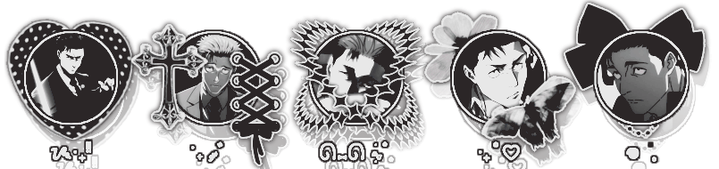

  <!-- 1. TOP LACE BORDER GRAPHIC -->
   

  <!-- 2. TEXT BANNER 1 -->
   

  

  <!-- 4. 3 IMAGES SIDE-BY-SIDE (No spaces between tags!) -->
   

  <!-- 5. TEXT BANNER 2 -->
   

  <!-- 6. BOTTOM FOOTER GRAPHIC -->
  

<!-- 3. MAIN CENTER ARTWORK -->
   
  <!-- 3. MAIN CENTER ARTWORK -->
   

 <!-- 6. BOTTOM FOOTER GRAPHIC -->
  
  
  <!-- 4. 3 IMAGES SIDE-BY-SIDE (No spaces between tags!) -->
   

  <!-- 1. TOP LACE BORDER GRAPHIC -->
   
