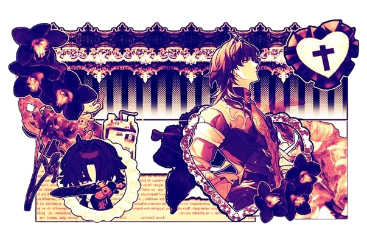

 <!-- 2. TEXT BANNER 1 -->
  <kbd>
  

  <!-- 2. TEXT BANNER 1 -->
  <kbd>
  

 $\color{#fdf8db}{\text{"A}}$  $\color{#ef473a}{\text{shell of}}$   $\color{#cb2c3e}{\text{their}}$   $\color{#31132d}{\text{former}}$   $\color{#ef473a}{\text{self."}}$

 $\color{#ef473a}{\text{ bmf / c+h . }}$ 

</kbd>

ㅤ࣪ㅤ $\color{#ef473a}{\text{heﾉhim/they.}}$
 $\color{#fdf8db}{\text{"Busy}}$  $\color{#ef473a}{\text{alot,}}$   $\color{#ef473a}{\text{Monday through}}$   $\color{#ef473a}{\text{Fri}}$   $\color{#ef473a}{\text{day."}}$

  
</kbd>

[wumble my wonderful github friend 𓏼](https://github.com/tirgery123)
    
  
