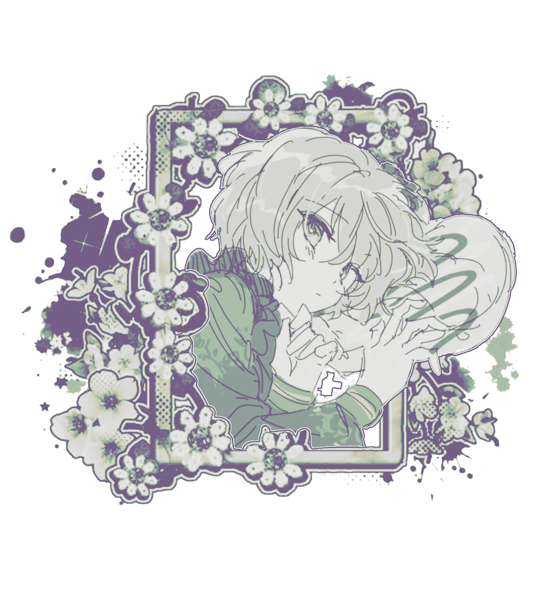

  <!-- 1. TOP LACE BORDER GRAPHIC -->
   
$\color{#fdf8db}{\text{"An}}$ $\color{#dae3c6}{\text{gel .}}$ $\color{#a2bcb9}{\text{Wi}}$  $\color{#939aa2}{\text{ngs."}}$ 

  <!-- 2. TEXT BANNER 1 -->
  

 $\color{#fdf8db}{\text{"Hold my}}$  $\color{#dae3c6}{\text{heart,}}$   $\color{#a2bcb9}{\text{its beating}}$   $\color{#939aa2}{\text{for you}}$   $\color{#66728a}{\text{anyways."}}$

 $\color{#fdf8db}{\text{ bmf or . }}$ $\color{#dae3c6}{\text{cuddle freely . !}}$ 

<kbd>
  
</kbd>

⏝⏝⏝ ⠀ ݁ ⠀꒡ ͝ ˖
၇ৎㅤ˖ㅤ࣪ㅤ $\color{#fdf8db}{\text{heﾉhim/they.}}$
. ݁ ˖ㅤ00 $\color{#dae3c6}{\text{wishing for 100 followerss . ,}}$

`Friendly!!` • `Offtab =slow response` • `INT`

[ata 𐂯ᩙ᩠𓏼](https://qngel.atabook.org) | [strawpage 𐂯ᩙ᩠𓏼](https://zanys-info.straw.page)

$\color{#fdf8db}{\text{────୨ৎ────}}$
$\color{#fdf8db}{\text{"𝑑𝑜𝑒𝑠 𝑚𝑦}}$  $\color{#dae3c6}{\text{𝑝𝑒𝑛 𝑜𝑛𝑙𝑦 }}$ $\color{#a2bcb9}{\text{𝑤𝑟𝑖𝑡𝑒
𝑏𝑖𝑡𝑡𝑒𝑟 }}$  $\color{#939aa2}{\text{𝑤𝑜𝑟𝑑𝑠 𝑓𝑜𝑟 𝑡ℎ𝑜𝑠𝑒}}$  $\color{#66728a}{\text{𝑤ℎ𝑜 𝑎𝑟𝑒 𝑑𝑒𝑎𝑟 𝑡𝑜 𝑚𝑒?”‧˚꒰🐾୭ ˚.}}$
$\color{#fdf8db}{\text{────୨ৎ────}}$

$\color{#fdf8db}{\text{ ᴍᴏᴏᴅ ʙᴏᴏsᴛ !}}$

 

  <!-- 1. TOP LACE BORDER GRAPHIC -->
   

    
  
