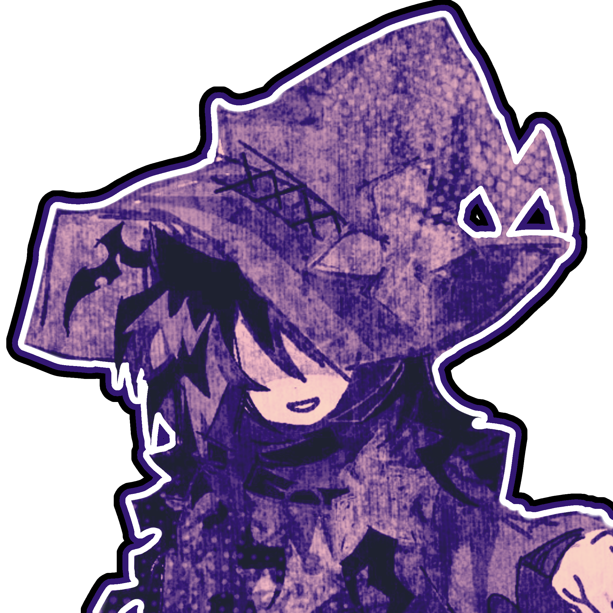

<!-- THE SIDE-BY-SIDE SPLIT LAYOUT -->
<table border="0" width="100%">
  <tr>
    <!-- LEFT SIDE: Main Visual Artwork -->
    <td width="45%" valign="top" align="center">
      
    </td>
 

<!-- THE SIDE-BY-SIDE SPLIT LAYOUT -->
<table border="0" width="100%">
  <tr>
    

    

<!-- THE SIDE-BY-SIDE SPLIT LAYOUT -->
<table border="0" width="100%">
<table>
  <tr>
    <!-- LEFT SIDE: CHARACTER ARTWORK -->
    <td valign="top" width="45%">
      <!-- Replace the URL below with your actual main character image link -->
      

This text will be light pink!
This text will be light purple!

