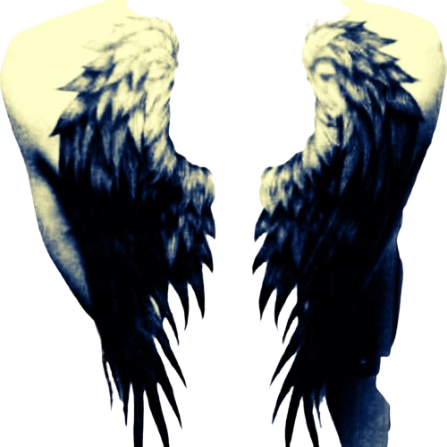

<!-- THE SIDE-BY-SIDE SPLIT LAYOUT -->
<table border="0" width="100%">
  <tr>
    <!-- LEFT SIDE: Main Visual Artwork -->
    <td width="45%" valign="top" align="center">
      
    </td>

<!-- THE SIDE-BY-SIDE SPLIT LAYOUT -->
<table border="0" width="100%">
  <tr>

 
 <td width="45%" valign="top" align="center">
      
    </td>

### Hello, I'm a Developer!
This text will automatically flow alongside the image on the left. 
You can keep typing sentences and paragraphs normally here, and GitHub 
will push everything down until it clears past the bottom of the right-aligned picture.

  
<h3>
  portfolio ✦ 
  contact ✦ 
  socials
</h3>
